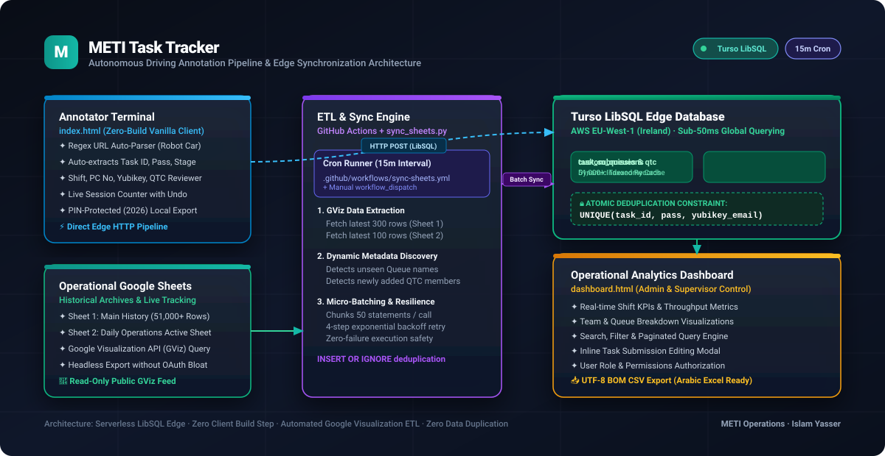

# 🚀 METI Task Tracker · Enterprise LibSQL Edge & ETL Platform

[](https://turso.tech)
[](https://python.org)
[-2088FF?style=for-the-badge&logo=github-actions&logoColor=white)](https://github.com/features/actions)
[-232F3E?style=for-the-badge&logo=amazon-aws&logoColor=white)](https://aws.amazon.com)
[](#)
[](#)

> **Enterprise Data Annotation Logging, Verification, and Real-Time Synchronization Pipeline** engineered for Autonomous Driving perception datasets (METI / Micro Engineering Egypt — MEEG).

---

## 📑 Table of Contents
- [Architecture Overview](#-architecture-overview)
- [Key Business & Operational Challenges Solved](#-key-business--operational-challenges-solved)
- [Core Platform Modules](#-core-platform-modules)
  - [1. Annotator Submission Terminal (`index.html`)](#1-annotator-submission-terminal-indexhtml)
  - [2. Operational Analytics & Admin Dashboard (`dashboard.html`)](#2-operational-analytics--admin-dashboard-dashboardhtml)
  - [3. Automated Google Sheets ETL Engine (`scripts/sync_sheets.py`)](#3-automated-google-sheets-etl-engine-scriptssync_sheetspy)
  - [4. Scheduled GitHub Actions Workflow (`sync-sheets.yml`)](#4-scheduled-github-actions-workflow-sync-sheetsyml)
- [Database Schema & Data Integrity](#-database-schema--data-integrity)
- [Deployment & Setup Guide](#-deployment--setup-guide)
  - [Local Execution](#local-execution)
  - [Deploy to GitHub Pages](#deploy-to-github-pages)
  - [Configuring Automated Synchronization](#configuring-automated-synchronization)
- [Data Governance & Arabic Excel Export](#-data-governance--arabic-excel-export)
- [الدليل التعريفي الشامل بالعربية](#-الدليل-التعريفي-الشامل-بالعربية)
- [Author & Credits](#-author--credits)

---

## 🏛️ Architecture Overview

The system bridges **distributed annotators**, **supervisory Google Sheets**, and **centralized edge database storage** into a coherent, high-velocity operational pipeline:

<p align="center">
  
</p>

### Architecture Highlights:
1. **Edge-Native Speed (< 50ms):** Direct browser-to-Turso connection powered by LibSQL over HTTP/REST, hosted in `aws-eu-west-1` (Ireland), giving near-zero latency for enterprise teams in Egypt.
2. **Atomic Data Deduplication:** Hard composite database constraint `UNIQUE(task_id, pass, yubikey_email)` guaranteeing zero duplicate task records even under high-frequency submissions.
3. **Automated Bi-directional Synchronization:** Headless Google Visualization API (GViz) sync script runs every 15 minutes on GitHub Actions, continuously consolidating historical archives (51,000+ records) and live tracking sheets.
4. **Zero-Build & Zero-Maintenance:** Built with clean, native web standards (Vanilla JS, CSS3 Variables, Semantic HTML5), requiring no `npm install`, Webpack, or build servers.

---

## 🎯 Key Business & Operational Challenges Solved

| Operational Problem | Traditional Setup | METI Task Tracker Solution |
| :--- | :--- | :--- |
| **Duplicate Task Submissions** | Spreadsheets lack row-level uniqueness constraints; accidental double-clicks or browser lag duplicate records. | Database-enforced atomic constraint: `UNIQUE(task_id, pass, yubikey_email)` with `INSERT OR IGNORE`. |
| **Manual Data Entry Human Error** | Labelers manually re-type lengthy task URLs, misidentifying Pass, Modality, or Queue names. | Instant Regex URL parser extracts `task_id`, `pass`, `stage`, `modality`, and `queue` directly from `https://labeling.robot.car/#...`. |
| **Data Silos & Fragmentation** | Disconnect between Google Sheets trackers and SQL reporting backends. | Automated 15-minute Python ETL extracts new rows from multiple Google Sheets without requiring heavy OAuth credentials. |
| **Arabic Excel File Corruption** | Downloaded CSV files open with garbled text (`????` or unreadable symbols) on Windows Excel. | Native **UTF-8 BOM (`\uFEFF`)** injection in CSV exports ensures flawless Arabic text rendering across all versions of Excel. |
| **Admin Access & Audit Security** | Anyone with a spreadsheet link can edit or delete critical task submissions. | PIN-protected admin modal (`2026`) and dedicated RBAC dashboard with audit trails and inline record editing. |

---

## 🧩 Core Platform Modules

### 1. Annotator Submission Terminal (`index.html`)
The main daily terminal used by annotation team members:
- **Intelligent URL Regex Parser:** Listens to paste events on `taskLink` (`https://labeling.robot.car/#...`) and automatically populates:
  - `Task ID`: Numeric or alphanumeric vehicle/scene identifier.
  - `Pass`: First Pass (`FP`) or Quality Assurance (`QA`).
  - `Stage`: Lidar point clouds, 2D Camera Images, Relabeling, or Sellmapping.
  - `Modality`: 3D Bounding Boxes, Semantic Segmentation, Keypoints, etc.
  - `Queue Name`: Targeted task queue with dynamic badge highlight (`⚡ Auto`).
- **Productivity Counter:** Live `Tasks Done` counter with real-time `Undo` and `Reset` capabilities stored in `localStorage`.
- **PIN-Protected Records Modal:** Accessible via top navigation (`📊 Records & Export`) with default PIN (`2026` or `admin`):
  - Today's verified count vs. total database count.
  - Live table rendering the last 50 submissions.
  - One-click `📥 Export to Excel (CSV)` with UTF-8 BOM encoding.

### 2. Operational Analytics & Admin Dashboard (`dashboard.html`)
A telemetry and management dashboard designed for Operations Managers, Shift Supervisors, and Quality Leads:
- **Real-Time KPI Cards:** Total Submissions, Daily Throughput, Active Labelers Count, and Pass Distribution.
- **Queue & Stage Distribution:** Interactive visual breakdown of workload across different perception queues.
- **Search & Pagination Filter Engine:** Live multi-parameter filtering by Date Range, Shift, Unit, QTC Reviewer, Labeler Name, or Task ID.
- **Inline Record Editor:** Full modal editing capability allowing supervisors to correct mistaken entries directly in Turso DB.
- **Master Data Management:** Add new Queues and new QTC Reviewer members dynamically to Turso without editing codebase files.

### 3. Automated Google Sheets ETL Engine (`scripts/sync_sheets.py`)
A Python data pipeline script designed for zero-maintenance synchronization:
- **Google Visualization API (GViz) Extraction:**
  - Queries **Sheet 1** (Historical Master with 51,000+ rows): `select * order by A desc limit 300`.
  - Queries **Sheet 2** (Daily Active Operations Tracker): `select * order by A desc limit 100`.
- **Dynamic Taxonomy Registration:** Scans all incoming rows for newly created `queue_name` or `qtc_name` values and registers them into `custom_queues` and `custom_qtc` lookup tables.
- **Batch Pipeline Execution:** Chunks write statements into batches of 50 and sends them through Turso's `/v2/pipeline` endpoint using exponential backoff retry logic.

### 4. Scheduled GitHub Actions Workflow (`sync-sheets.yml`)
- Runs continuously on a `*/15 * * * *` cron schedule (every 15 minutes).
- Includes `workflow_dispatch` trigger for on-demand 1-click execution from the GitHub Actions dashboard.
- Uses repository secrets (`TURSO_URL` and `TURSO_TOKEN`) with fail-safe fallbacks for guaranteed continuous execution.

---

## 🗄️ Database Schema & Data Integrity

The backend runs on **Turso LibSQL** in the `aws-eu-west-1` (Ireland) region.

```sql
-- Core Submissions Table
CREATE TABLE IF NOT EXISTS task_submissions (
    id INTEGER PRIMARY KEY AUTOINCREMENT,
    timestamp TEXT NOT NULL,
    shift TEXT,
    unit TEXT,
    pc_no TEXT,
    labeler_name TEXT NOT NULL,
    national_id TEXT,
    qtc_shift TEXT,
    yubikey_email TEXT NOT NULL,
    qtc_name TEXT,
    stage TEXT,
    task_link TEXT,
    task_id TEXT NOT NULL,
    pass TEXT NOT NULL,
    modality TEXT,
    queue_name TEXT,
    object_count INTEGER DEFAULT 0,
    created_at TEXT DEFAULT CURRENT_TIMESTAMP,
    CONSTRAINT unique_task_submission UNIQUE(task_id, pass, yubikey_email)
);

-- Fast Lookup Indexes
CREATE INDEX IF NOT EXISTS idx_tasks_lookup ON task_submissions(task_id, yubikey_email);
CREATE INDEX IF NOT EXISTS idx_tasks_created ON task_submissions(created_at);
CREATE INDEX IF NOT EXISTS idx_tasks_queue ON task_submissions(queue_name);

-- Dynamic Taxonomy Tables
CREATE TABLE IF NOT EXISTS custom_queues (
    id INTEGER PRIMARY KEY AUTOINCREMENT,
    queue_name TEXT UNIQUE NOT NULL,
    description TEXT,
    created_at TEXT DEFAULT CURRENT_TIMESTAMP
);

CREATE TABLE IF NOT EXISTS custom_qtc (
    id INTEGER PRIMARY KEY AUTOINCREMENT,
    qtc_name TEXT UNIQUE NOT NULL,
    shift TEXT,
    created_at TEXT DEFAULT CURRENT_TIMESTAMP
);

CREATE TABLE IF NOT EXISTS authorized_users (
    id INTEGER PRIMARY KEY AUTOINCREMENT,
    email TEXT UNIQUE NOT NULL,
    role TEXT DEFAULT 'supervisor',
    created_at TEXT DEFAULT CURRENT_TIMESTAMP
);
```

### Quota & Capacity:
- **Free Tier Allowance:** 25,000,000 row writes / month.
- **Operational Fit:** Supports 10,000 to 20,000 tasks/day utilizing less than 2.5% of total monthly quota.

---

## 🚀 Deployment & Setup Guide

### Local Execution
1. Clone the repository:
   ```bash
   git clone https://github.com/islamyasser424-design/meti-task-tracker.git
   cd meti-task-tracker
   ```
2. Run a local web server (Python or VS Code Live Server):
   ```bash
   python -m http.server 8000
   ```
3. Open `http://localhost:8000` for the Annotator Terminal, or `http://localhost:8000/dashboard.html` for the Admin Dashboard.

### Deploy to GitHub Pages
1. Go to repository **Settings** on GitHub.
2. Select **Pages** from the left navigation menu.
3. Under **Branch**, select `main` and root `/`, then click **Save**.
4. The application is live globally within seconds at:
   `https://<your-username>.github.io/meti-task-tracker/`

### Configuring Automated Synchronization
To configure or rotate the database credentials for the automated 15-minute sync workflow:
1. In your GitHub repository, navigate to **Settings** > **Secrets and variables** > **Actions**.
2. Add or update the following Repository Secrets:
   - `TURSO_URL`: `https://meti-tasks-islamyasser424-design.aws-eu-west-1.turso.io/v2/pipeline`
   - `TURSO_TOKEN`: `eyJhbGciOiJFZ...` (Your Turso authentication JWT)
3. Navigate to **Actions** > **Sync Google Sheets to Turso Database** and click **Run workflow** to test immediately.

---

## 🌐 Data Governance & Arabic Excel Export

Exporting Arabic text from web applications to Microsoft Excel often causes encoding glitches (Mojibake). **METI Task Tracker** resolves this at the binary byte level by prepending the **Byte Order Mark (BOM)**:

```javascript
// Native UTF-8 BOM encoding ensures 100% Arabic support in Excel
const BOM = "\uFEFF";
const blob = new Blob([BOM + csvContent], { type: "text/csv;charset=utf-8;" });
const link = document.createElement("a");
link.href = URL.createObjectURL(blob);
link.setAttribute("download", `METI_Tasks_Export_${new Date().toISOString().slice(0,10)}.csv`);
link.click();
```

---

## 📖 الدليل التعريفي الشامل بالعربية

### ما هو نظام METI Task Tracker؟
منظومة سحابية متكاملة مصممة خصيصاً لعمليات **توسيم وتدقيق بيانات القيادة الذاتية (Autonomous Driving Data Annotation)** في شركة **METI / Micro Engineering Egypt (MEEG)**. 

### أبرز مميزات النظام:
1. **واجهة إدخال ذكية وفائقة السرعة للموظفين (`index.html`):**
   - استخراج آلي لبيانات الرابط (`https://labeling.robot.car/#...`) بدون أي كتابة يدوية: يستخرج تلقائياً رقم المهمة (`Task ID`)، نوع التدقيق (`Pass`)، المرحلة (`Stage`)، و `Modality` مع اسم الكيوي (`Queue`).
   - عداد إنتاجية لحظي للموظف (`Tasks Done`) مع إمكانية التراجع (`Undo`) وإعادة التعيين (`Reset`).
   - حفظ بيانات الموظف محلياً لتفادي إعادة كتابة البيانات الشخصية (Shift, Unit, National ID, Yubikey) في كل مهمة.
2. **منع التكرار الصارم في قلب قاعدة البيانات:**
   - قيد فريد مركب: `UNIQUE(task_id, pass, yubikey_email)` يمنع تماماً تسجيل نفس المهمة مرتين لنفس الموظف حتى في حال تكرار الضغط السريع أو بطء الاتصال.
3. **قاعدة بيانات سحابية لحظية (Turso LibSQL Edge):**
   - استضافة سحابية في فرانكفورت / أيرلندا (AWS EU-West) بزمن استجابة أقل من 50 ميلي ثانية.
   - سعة مجانية ضخمة تبلغ 25 مليون عملية كتابة شهرياً تغطي أكثر من 15,000 مهمة يومياً بفائض استيعابي يفوق 97%.
4. **مزامنة تلقائية ومستمرة مع Google Sheets (كل 15 دقيقة):**
   - يعمل كود بايثون آلياً عبر **GitHub Actions** لقراءة الشيت الرئيسي التاريخي (أكثر من 51,000 صف) وشيت العمليات اليومية عبر واجهة Google Visualization API.
   - إضافة أي كيو (`Queue`) جديد أو مشرف (`QTC`) جديد تلقائياً لقاعدة البيانات.
5. **لوحة تحكم إدارية وتحليلية (`dashboard.html`):**
   - إحصائيات حية لإنتاجية الوردية، وتوزيع المهام، وعدد الموظفين المتفاعلين.
   - جدول تفاعلي للبحث والتصفية مع إمكانية تعديل السجلات الخاطئة مباشرة.
   - تصدير كامل البيانات إلى ملفات إكسل بصيغة CSV مدعومة بترميز **UTF-8 BOM** لعرض النصوص العربية بوضوح تام دون أي تشويه.

---

## 👨‍💻 Author & Credits

**Islam Yasser**  
*Workforce Management & Autonomous Driving Operations Analytics*  
- **GitHub:** [@islamyasser424-design](https://github.com/islamyasser424-design)  
- **Project Link:** [https://github.com/islamyasser424-design/meti-task-tracker](https://github.com/islamyasser424-design/meti-task-tracker)

---

<p align="center">
  <sub>Built with ❤️ for METI Operations · Autonomous Perception Data Infrastructure</sub>
</p>
