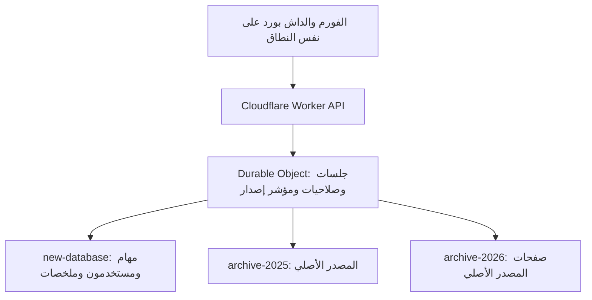

# METI Task Tracker — النسخة المستقلة للمراجعة

تسجيل دخول → تسجيل مهمة → تأكيد Turso → تحديث الداش بورد. هذه النسخة في `rebuild/` ولا تستبدل العامل أو قواعد D1/Turso القديمة تلقائيًا. لا يوجد نشر إنتاجي أو استيراد لبيانات الموظفين في هذا التغيير.

## التشغيل والفحص

يتطلب Node 24. من هذا المجلد:

```bash
npm ci
npm test
npm run build
npm run test:runtime
npm run test:dom
npx playwright install --with-deps chromium
npm run test:e2e
npm run benchmark
```

`build` يجمع العامل بواسطة `wrangler deploy --dry-run` ولا ينشره. كل الاختبارات تستخدم بيانات مصطنعة وقواعد مؤقتة. اختبار runtime يشغّل **workerd وDurable Object SQLite** والعميل الرسمي libSQL HTTP أمام SQLite محلية؛ لا يدّعي أنه اختبار خدمة Turso السحابية. توجد إعدادات اختبار الواجهة والمحاكاة في CI دون أسرار إنتاج.

للتشغيل المتصل ببيئة مراجعة خاصة: اتبع [دليل التشغيل والأسرار](docs/OPERATIONS.md). لا تضع قيم الاتصال أو بيانات الأرشيف في Git.

## المعمارية المختارة



المتصفح يستخدم `/api/` فقط. ملفات الواجهة تخدمها Workers Static Assets. لا proxy لصفحات GitHub القديمة ولا اتصال متصفح بقاعدة البيانات. الاتصالات الثلاثة منفصلة ولا توجد آلية fallback إلى قاعدة أخرى. أسرار الخادم المطلوبة: `ARCHIVE_2025_URL` و`ARCHIVE_2025_TOKEN` و`ARCHIVE_2026_URL` و`ARCHIVE_2026_TOKEN` و`LIVE_DB_URL` و`LIVE_DB_TOKEN` و`AUTH_PEPPER`.

استُخدم Durable Object واحد باسم ثابت لأن ذاكرة كل Worker isolate ليست مشتركة. هو يخزن مؤشر الإصدار والجلسات وحدود الدخول فقط، وليس مهام Turso. يحتفظ بصف لكل نطاق: الفريق أو صاحب المهمة. تغيير مستخدم لا يبطل نطاق مستخدم عادي آخر. التنفيذ المتسلسل داخل المنسق يمنع سباق إشعار الحفظ واسترداد حالته. هذا الاختيار له حدود تحميل وتكلفة موضحة في [نتائج الفحص](docs/VALIDATION.md).

### الحفظ

1. فحص الجلسة وOrigin وCSRF والحقول. اسم المسجّل ومعرّفه يؤخذان من الحساب على الخادم. لا تُجمع أرقام الهوية الوطنية أو بيانات Yubikey في نموذج المهام الجديد.
2. تحفظ الواجهة جسم المحاولة وUUID ثابتًا في sessionStorage قبل الإرسال، مقيدًا بمعرف الحساب. عند ضياع الرد أو إعادة فتح التبويب تستخدم نفس الجسم والمفتاح حتى التأكيد. كلمات المرور ورموز الجلسة لا تحفظ في Web Storage.
3. `UNIQUE(owner_id,idempotency_key)` يمنع ازدواج إعادة المحاولة. تخزين بصمة الجسم يكشف إعادة استخدام المفتاح مع بيانات مختلفة ويعيد 409.
4. قاعدة business dedup مأخوذة من migration القديمة 0002: المهمة + المسجّل + وقت حدوث التسجيل + pass. استخدمنا معرف الحساب الثابت بدل الاسم القابل للتغيير، وترميز JSON ثم SHA-256 بدل فصل القيم بعلامة `|`. اختلاف pass أو المسجّل أو وقت الحدث يسمح بتسجيل مشروع آخر للمهمة نفسها. هذا يحل تعارض migration مع فحص الفورم القديم؛ راجع [مراجعة الكود](docs/REVIEW.md) قبل اعتماد قاعدة عمل مختلفة.
5. العميل الرسمي `@libsql/client/web` ينفذ INSERT وقراءة نتيجة المفتاح والملخص داخل `batch(...,'write')`. Triggers تضيف سجل التغيير وتحدث الإجمالي واليوم لكل من الفريق وصاحب المهمة داخل نفس المعاملة. أي فشل يلغيها كلها.
6. لا يعود نجاح إلا بعد commit ومعه `task.id` و`created_at` من القاعدة و`server_time`. يدمج العميل الصف المؤكد فورًا دون جلب قائمة المهام.

المهام append-only في هذه النسخة. PUT/PATCH/DELETE تعيد 405، وتمنع triggers التعديل والحذف المباشر أيضًا. إضافة تحرير لاحقًا تتطلب migration لسجل أحداث insert/update/delete، وتطبيق الفروق السالبة والموجبة على الملخصات، واختبارات جديدة؛ لا تستخدم timestamp وحده.

### تحديث المستخدم الآخر

الاختيار الحالي **polling كل 15 ثانية أثناء ظهور الصفحة**؛ زمن الظهور المتوقع نحو 15 ثانية + زمن الطلب في الحالة الطبيعية. الأخطاء والحصة المتجاوزة قد تطيل ذلك. لا نسميه بثًا لحظيًا.

- `/api/tasks/version` يفحص مؤشرًا في Durable Object. لا ينفذ فحص تغييرات في Turso. يعاد فحص صلاحية الحساب في Turso كل 60 ثانية بحد أقصى؛ تحديث الدور/التعطيل من API الإدارة يلغي الجلسات فورًا.
- عند اختلاف المؤشر فقط تجلب الواجهة `changes?cursor=<seq>` بصفحات أقصاها 100. `seq` متزايد مستقل عن timestamps، ومحفوظ دائمًا في Turso. إعادة الاتصال تكمل من آخر صفحة طُبقت. لا يُقفز بالمؤشر إلى آخر مهمة أرسلها المستخدم، حتى لا يتخطى تغييرات الآخرين.
- الملخص وصفحة البداية يحصلان على snapshot متوافق داخل معاملة واحدة. صفحات التفاصيل تعتمد seq، دون OFFSET أو COUNT شامل.
- في عميل runtime تُوجّه snapshots الجديدة وفحص المستخدم إلى primary باستعمال معاملة قصيرة BEGIN IMMEDIATE حتى لو احتوت SELECT فقط؛ هذا يتجنب تأخر replica بعد تغير المؤشر، ولا يعدّل صفوفًا. اتصالات الأرشيف تظل read-only بعد اكتمال الاستيراد والنسخ.
- قبل محاولة الكتابة يثبت المنسق علامة `dirty`. بعد تأكيد commit يحدّث مؤشري الفريق والمستخدم ثم يمسحها. إذا وقع crash بينهما، يعيد أول طلب استرداد قراءة صف إصدار واحد من Turso ويغير epoch لكل النطاقات. يعيد العملاء التحقق من سجل التغييرات. فشل مؤشر الإصدار لا يفقد مهمة محفوظة ولا يعلن نجاحًا غير مؤكد.
- تتوقف مواعيد polling عند إخفاء الصفحة، وتستأنف عند الظهور/عودة الشبكة. backoff متزايد حتى خمس دقائق ويحترم Retry-After الأطول. تعرض الشاشة 100 صف كحد أقصى؛ بقية البيانات عبر صفحات.
- لا WebSocket أو SSE منشور في هذه النسخة. البث عبر نسخ Workers يحتاج منسقًا مشتركًا وإدارة حياة الاتصالات، وفي حالة WebSocket يفضل Hibernation API. يلزم قياس بديل WebSocket إذا كان عدد الشاشات يستهلك حد طلبات polling؛ لا تكفي Map في isolate لعمل broadcast عالمي.

## الصلاحيات وAPI

| API | operator | supervisor | admin |
|---|---|---|---|
| `POST /api/tasks` | يسجل باسمه | يسجل باسمه | يسجل باسمه |
| `GET /api/tasks?source=new&cursor=...` | مهامه فقط | الفريق | الفريق |
| `GET /api/tasks/changes?cursor=...` | تغييراته فقط | الفريق | الفريق |
| `GET /api/tasks/version` | مؤشر نطاقه | مؤشر الفريق | مؤشر الفريق |
| `GET /api/reports/summary?source=new` | ملخصه | ملخص الفريق | ملخص الفريق |
| `GET /api/archive/2025` أو `2026` | 403 | مسموح | مسموح |
| تقارير `2025/2026/all` | 403 | مسموح | مسموح |
| `GET /api/tasks/export?cursor=...` | 403 | 403 | CSV محدود بصفحة |
| `PATCH /api/admin/users/:id` | 403 | 403 | تغيير دور/حالة حساب آخر |

كما توجد `POST /api/auth/login` و`POST /api/auth/logout` و`GET /api/me`. كل mutation تتطلب نفس Origin؛ كل mutation بعد الدخول تتطلب `X-CSRF-Token`. نجاح الدخول يضع cookie HttpOnly / Secure / SameSite=Strict ببادئة `__Host-` لمدة 8 ساعات. النشر مصمم على نفس النطاق، فلا توجد قائمة CORS مفتوحة ولا bearer token في localStorage.

## الأرشيف والتقارير

الاستيراد raw: جدول مستقل لكل صفحة مع `source_row` و`c001..cNNN TEXT`. يبقى مصدر الصفحة في registry يربطها بجدولها. جدول `meti_archive_columns` يحفظ الترتيب والعنوان الأصلي حتى لو كان فارغًا أو مكررًا. لا يوجد تحويل إلى شكل مهمة موحّد أثناء التخزين.

مفتاح المصدر + بصمة الملف يمنع استبدال صفحة أو تكرار ملف بالخطأ، ورقم الصف يمنع مضاعفة الدفعات. checkpoint يحدث في معاملة الدفعة نفسها. يراجع المستورد مرة واحدة count وتسلسل الصفوف وSHA-256 لكل القيم المقروءة بالترتيب؛ تكرار ملف مكتمل هو no-op بعد التحقق من بصمته محليًا.

ملخص raw_rows يُبنى عند اكتمال الاستيراد. لا تُستنتج دلالة أي عمود تلقائيًا. Mapping التقارير إجراء مستقل صريح، ويعتمد حاليًا عدد العناصر ووقت ISO8601 مع إقرار أن كل صف تسجيل مستقل. صيغ التواريخ الأخرى تحتاج parser معتمدًا قبل تفعيل الملخص. البيانات المخزنة لا تتغير. `source=all` يجمع الملخصات المتوافقة فقط وبعد اعتماد عدم التداخل وفحص حدود زمنية منفصلة لكل صفحة وقبل live cutover. خلاف ذلك يعيد `compatible:false, summary:null` مع حالة كل مصدر، ولا يعرض إجماليًا مضللًا.

عرض التفاصيل المجمعة عبر المصادر غير مدعوم: الواجهة تنتقل إلى مصدر/صفحة محددة، ولا تدمج raw datasets في الذاكرة. سجلات D1 الحالية خارج هذه المصادر الثلاثة لا تدخل في الحساب تلقائيًا.

## ما يحتاج استكمالًا قبل الإنتاج

- ملفا الأرشيف الحقيقيان غير موجودين في هذا checkout أو المحادثة. أعداد 54,539×26 و34,635×20 هي الأعداد المذكورة في الطلب، ولم تُتحقق فعليًا بعد. راجع كون عدد الصفوف يستثني العناوين قبل تحديد manifest.
- اعتماد معاني الأعمدة المتكررة/الغامضة وparser التاريخ ودلالة «التسجيل» وحدود كل صفحة. الملخصات المتقدمة القديمة لم تُنقل دون هذا الاعتماد.
- ضبط الأسرار وأدوار المستخدمين في منصة مراجعة خاصة، ثم تنفيذ قياس Turso السحابي واختبار النسخ الاحتياطية الحقيقية. ملفات الموظفين والأسرار لا ترسل في الدردشة.
- اعتماد النتيجة قبل تحويل النطاق وتعطيل مصادر التسجيل والمزامنة القديمة. الخطة المجانية ليست ضمان توافر؛ القواعد الثلاث تشترك في حصة الحساب.
